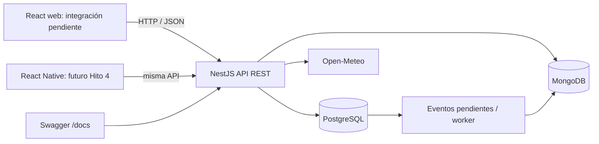

# TripPlan — frontend React y API de viajes

Continuación del Taller 2 para el Hito 3 de Desarrollo Web y Móvil. Se conserva la aplicación React + Vite y se incorpora un backend propio en `backend/`.

La API usa NestJS + TypeScript, PostgreSQL + TypeORM, MongoDB + Mongoose, autenticación JWT y Swagger/OpenAPI. El mismo contrato REST puede utilizarse desde React Native en el Hito 4.

**Estado del alcance:** el backend implementa usuarios, viajeros, viajes, destinos, itinerarios diarios, actividades, reservas simuladas, favoritos personales, gastos, indicadores, notas, recomendaciones e historial. La interfaz React original todavía utiliza sus datos locales y `localStorage`: su conexión a esta API y las pantallas nuevas constituyen una etapa posterior de integración. Levantar el contenedor frontend no realiza esa integración automáticamente. El backend se puede utilizar y demostrar desde Swagger.

## Empezar en Windows

Sigue [INICIAR_BACKEND.md](INICIAR_BACKEND.md), que explica la instalación de Docker Desktop, los comandos exactos, Swagger y la prueba con bases de datos reales.

Desde esta carpeta, con Docker Desktop abierto:

```powershell
node backend/scripts/setup-env.mjs
docker compose up --build -d
docker compose exec backend node dist/database/seed.js
docker compose exec backend npm run smoke
```

El primer comando genera configuración local con claves aleatorias y conserva archivos `.env` existentes. Las migraciones se ejecutan al iniciar la API; el seed es opcional y repetible.

| Servicio | Dirección local |
| --- | --- |
| Swagger interactivo | http://localhost:3000/docs |
| API REST | http://localhost:3000/api/v1 |
| Estado SQL y MongoDB | http://localhost:3000/api/v1/health |
| Interfaz original | http://localhost:8080 |
| PostgreSQL | localhost:5432 |
| MongoDB | localhost:27017 |

## Arquitectura



Reglas, modelo de datos, módulos, permisos y endpoints se describen en [backend/README.md](backend/README.md). El [contrato OpenAPI exportado](backend/docs/openapi.json) se genera a partir de los mismos controladores que usa la API.

## Desarrollo y pruebas

Frontend, desde la raíz:

```powershell
npm.cmd ci
npm.cmd run dev
npm.cmd run build
npm.cmd run lint
```

Backend, desde `backend/`:

```powershell
npm.cmd ci
npm.cmd run typecheck
npm.cmd test
npm.cmd run build
npm.cmd run openapi
```

Las pruebas automáticas HTTP usan la migración SQL real sobre `pg-mem`. También se prueban validación de documentos, permisos de notas, reintentos de eventos y clima con dependencias simuladas. Esto no reemplaza ejecutar `npm run smoke` con PostgreSQL y MongoDB reales. La guía explica ambas modalidades.

El **10 de noviembre de 2026** se completó la prueba `smoke` con PostgreSQL y MongoDB reales en Docker Desktop para Windows. Los cuatro servicios quedaron ejecutándose; las dos bases y el backend reportaron estado saludable. También se verificaron Swagger (52 operaciones), acceso HTTP a la web, el viaje de demostración persistido y siete días de pronóstico real desde Open-Meteo.

Con los servicios iniciados y el seed cargado, puedes repetir la comprobación de solo lectura desde la raíz:

```powershell
node backend/scripts/check-runtime.mjs
```

Este comando usa la cuenta demo configurada localmente y no imprime contraseñas ni tokens. Verificar que la web responde HTTP 200 no implica que sus pantallas ya estén conectadas a la API.

## Continuidad y decisiones

- Se conservan componentes, navegación e integración meteorológica del Taller 2. Su documentación original e integrantes están en [README.md.md](README.md.md).
- Se incorpora una API organizada en controladores, servicios, DTO, entidades/esquemas y configuración.
- PostgreSQL concentra la información relacional; MongoDB guarda contenido documental e historial. No se copian viajes ni gastos completos a MongoDB.
- El presupuesto usa CLP y distingue estimaciones de actividades de gastos reales.
- Los propietarios administran sus viajes. Los viajeros asociados tienen lectura y favoritos personales.
- No hay pagos comerciales: las reservas son registros administrativos simulados.
- Docker Compose incluye volúmenes para conservar datos al detener servicios. `.env` queda fuera de Git; se entregan `.env.example` y un generador local.

## API pública

Se conserva [Open-Meteo](https://open-meteo.com/en/docs). La nueva API puede consultar `GET https://api.open-meteo.com/v1/forecast` desde el servidor y ofrecer el resultado en `GET /api/v1/trips/{tripId}/weather?destinationId={id}`. Se usan coordenadas, fechas, temperatura, precipitaciones y código meteorológico. El backend agrega autorización, caché de diez minutos, timeout de ocho segundos y un mensaje para fechas fuera del horizonte. La integración directa del frontend original permanece hasta conectar sus pantallas.

## Uso de Inteligencia Artificial

Se utilizó Codex como apoyo para diseñar e implementar el backend, elaborar migraciones, pruebas y documentación.

- **Instrucción representativa:** crear el backend de TripPlan con NestJS, PostgreSQL, MongoDB, Swagger y Docker Compose, respetando el enunciado del Hito 3.
- **Resultado:** código de API, modelo SQL y documental, validaciones, pruebas y guía de ejecución.
- **Validación automatizada:** compilación TypeScript, veinte pruebas HTTP/reglas de negocio, documentos, eventos y clima, y compilación del frontend. Se ejecutaron además el flujo `smoke` sobre PostgreSQL y MongoDB reales y la comprobación local de servicios, Swagger, datos demo y Open-Meteo.
- **Validación humana:** pendiente de que el equipo revise el código, ejecute la demostración y registre lo que adaptó o descartó. No se atribuye una revisión humana que todavía no se ha realizado.
- **Aprendizaje a documentar por el equipo:** relaciones entre entidades, permisos, separación SQL/NoSQL, diferencia entre presupuesto y gasto real, y reutilización de la API desde móvil.

## Limitaciones conocidas

La integración de las pantallas React está pendiente. No hay recuperación de contraseña, verificación de correo, conversión de monedas, pagos reales ni colaboración con edición simultánea por invitados. Los JWT expiran en una hora; se renuevan iniciando sesión. La ejecución con contenedores y el flujo principal del backend ya se verificaron con Docker Desktop en Windows.
