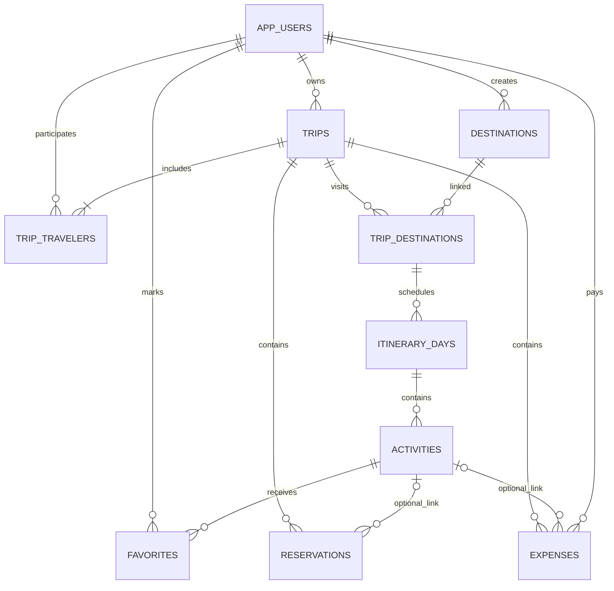

# TripPlan API

Backend REST del sistema de planificación de viajes, separado del frontend React. Su API se reutilizará desde React Native.

## Tecnologías y organización

NestJS 11, TypeScript 5, PostgreSQL 17, TypeORM 0.3, MongoDB 8, Mongoose 8, JWT HS256, bcrypt y Swagger/OpenAPI. El lockfile fija las versiones instaladas. Los contenedores usan Node.js 22; el equipo local de implementación tenía Node.js 26.

```text
backend/
  src/
    auth/          Registro, login, perfil y guard JWT
    trips/         Viajes, viajeros, destinos asociados y permisos
    destinations/  Catálogo compartido de destinos
    planning/      Días, actividades, favoritos, reservas y gastos
    documents/     Notas, recomendaciones e historial MongoDB
    audit/         Outbox SQL y entrega idempotente a MongoDB
    weather/       Adaptador Open-Meteo
    database/      Entidades, migración inicial y seed
    common/        Validación, identificadores y formato de errores
    config/        Validación de variables de entorno
  test/            HTTP, reglas de negocio, documentos, eventos y clima
  scripts/         Configuración local, exportación OpenAPI y smoke
  docs/openapi.json
```

Cada módulo separa controladores HTTP, DTO de entrada y servicios de negocio. Las entidades SQL y esquemas documentales definen persistencia; las credenciales se leen de variables de entorno. No se usa `synchronize`: el esquema se crea mediante una migración versionada.

## Ejecutar

El recorrido de instalación y demostración está en [../INICIAR_BACKEND.md](../INICIAR_BACKEND.md).

Desde la raíz del repositorio:

```powershell
node backend/scripts/setup-env.mjs
docker compose up --build -d
docker compose exec backend node dist/database/seed.js
docker compose exec backend npm run smoke
```

Swagger: `http://localhost:3000/docs`. Contrato en ejecución: `http://localhost:3000/docs-json`. Prefijo de todas las rutas: `/api/v1`.

## Modelo relacional



| Tabla | Uso y restricciones principales |
| --- | --- |
| `app_users` | UUID, nombre, correo único normalizado y hash de contraseña oculto en consultas normales. |
| `trips` | Propietario, fechas, descripción y presupuesto CLP. Fecha final igual o posterior al inicio. |
| `trip_travelers` | Membresía única por viaje/usuario. Incluye al propietario. |
| `destinations` | Catálogo compartido con país, región y coordenadas válidas. |
| `trip_destinations` | Relación muchos a muchos entre viajes y destinos. |
| `itinerary_days` | Un registro por fecha/viaje. Su destino debe estar asociado al mismo viaje. |
| `activities` | Día, horario, categoría, costo estimado y estado. FK compuesta evita vincular un día ajeno. |
| `favorites` | Favorito único por usuario/actividad; no es una marca global. |
| `reservations` | Reserva simulada de alojamiento, transporte, actividad u otro servicio. Vínculo opcional a una actividad del mismo viaje. |
| `expenses` | Pago real positivo, fecha, categoría y quién pagó. Vínculo opcional a actividad del mismo viaje. |
| `audit_outbox` | Cola técnica de eventos confirmados en la transacción SQL, con identificador único y fecha de entrega. |

Se incluyen claves primarias/foráneas, restricciones de integridad e índices para consultas por propietario, viajero, viaje y fecha. `audit_outbox` no referencia por FK al viaje: el evento de eliminación debe sobrevivir al viaje eliminado.

## Uso de MongoDB

| Colección | Contenido | Función demostrable |
| --- | --- | --- |
| `trip_notes` | `tripId`, `authorId`, título, contenido, etiquetas y timestamps | Crear, consultar, editar y eliminar notas del viaje. |
| `trip_recommendations` | Contenido editorial, categoría, etiquetas y enlace opcional | Guardar y consultar recomendaciones manuales. |
| `trip_events` | Identificador único de evento, viaje, actor, acción, metadata y fecha | Consultar historial de operaciones SQL. |

Estos documentos complementan la información transaccional: no almacenan copias completas de usuarios, viajes, actividades ni gastos. El modelo documental agrupa contenido y etiquetas de notas/recomendaciones; los eventos admiten metadata distinta según la acción.

Los cambios de negocio SQL y su evento se confirman en la misma transacción. Un worker consulta la outbox cada 1,5 segundos y entrega hasta cincuenta eventos a MongoDB. Si falla la entrega, conserva el pendiente y reintenta. El `eventId` único permite repetir sin duplicar eventos. La API no afirma tener una transacción distribuida entre PostgreSQL y MongoDB: notas/recomendaciones se escriben directamente en MongoDB después de verificar permisos.

Eliminar un viaje quita sus datos SQL. El evento `trip.deleted` permite limpiar sus notas y recomendaciones de forma eventual. El historial técnico se conserva y ya no es accesible mediante un viaje eliminado.

## Permisos y reglas

- Registro e inicio de sesión son públicos. El estado de servicios también es público. El resto de la API exige `Authorization: Bearer <token>`.
- El token dura una hora. No se implementan refresh tokens; se vuelve a iniciar sesión.
- El propietario crea, modifica y elimina los recursos del viaje; administra viajeros y documentos. Los viajeros pueden consultar y administrar sus favoritos personales. Un tercero recibe 403 y no ve el viaje en su listado.
- Se agrega un viajero por el correo exacto de una cuenta registrada. El propietario no puede quitarse del viaje. No existe un directorio público de usuarios.
- El catálogo de destinos es compartido. Solo su creador lo modifica o elimina; no se puede borrar un destino asociado a viajes.
- Un día del itinerario debe estar dentro de las fechas del viaje y usar un destino asociado. No se repite la fecha dentro del mismo viaje.
- No se puede acortar un viaje dejando días o reservas fuera de sus fechas.
- Los gastos representan pagos reales y pueden registrarse antes de la salida. Los importes son enteros CLP; se rechazan importes negativos y gastos de cero. El límite por importe es un billón de pesos (`1000000000000`).
- Quien paga un gasto debe pertenecer al viaje al registrarlo. Si posteriormente se retira al viajero, se conserva la referencia histórica al usuario.
- `estimatedActivitiesCost` suma costos de actividades no canceladas. `spent` suma gastos reales; `remaining = budget - spent`. Se permite exceder el presupuesto y se informa con `overBudget`. No se suman reservas y actividades juntas como si fueran gastos pagados.
- Las reservas son simuladas. Sus fechas deben caer dentro del viaje. Una reserva cancelada no se reactiva; se crea otra.
- Se impide borrar actividades que aún tengan gastos o reservas vinculadas. Los vínculos opcionales se pueden quitar enviando `activityId: null`.
- Los cambios SQL sobre un mismo viaje se serializan con bloqueo de fila para mantener consistentes las validaciones.

## Endpoints

Todas las rutas siguientes tienen el prefijo `/api/v1`. Las listas paginadas usan `limit` (por defecto 50, máximo 100) y `offset` (por defecto 0), y devuelven arrays. Viajeros y destinos asociados son listas completas del viaje.

| Método | Ruta | Propósito |
| --- | --- | --- |
| POST | `/auth/register` | Registrar cuenta y obtener token. |
| POST | `/auth/login` | Obtener token con correo/contraseña. |
| GET/PATCH | `/users/me` | Leer perfil o cambiar nombre. |
| GET/POST | `/trips` | Listar mis viajes o crear uno. |
| GET/PATCH/DELETE | `/trips/{tripId}` | Leer, modificar o eliminar viaje. |
| GET | `/trips/{tripId}/summary` | Presupuesto e indicadores calculados. |
| GET/POST | `/trips/{tripId}/travelers` | Consultar o agregar viajeros. |
| DELETE | `/trips/{tripId}/travelers/{id}` | Quitar un viajero. |
| GET/POST | `/destinations` | Buscar o crear destinos del catálogo. |
| GET/PATCH/DELETE | `/destinations/{id}` | Consultar, editar o eliminar destino. |
| GET/POST | `/trips/{tripId}/destinations` | Consultar o asociar destinos. |
| DELETE | `/trips/{tripId}/destinations/{id}` | Desasociar destino sin uso. |
| GET/POST | `/trips/{tripId}/days` | Consultar o crear días del itinerario. |
| PATCH/DELETE | `/trips/{tripId}/days/{id}` | Editar o eliminar día vacío. |
| GET/POST | `/trips/{tripId}/activities` | Filtrar o crear actividades. |
| GET/PATCH/DELETE | `/trips/{tripId}/activities/{id}` | Consultar, editar, completar o eliminar actividad. |
| GET | `/trips/{tripId}/favorites` | Consultar mis favoritos de ese viaje. |
| PUT/DELETE | `/trips/{tripId}/activities/{id}/favorite` | Marcar/desmarcar favorito personal. |
| GET/POST | `/trips/{tripId}/expenses` | Consultar o registrar gastos reales. |
| PATCH/DELETE | `/trips/{tripId}/expenses/{id}` | Modificar o eliminar gasto. |
| GET/POST | `/trips/{tripId}/reservations` | Consultar o crear reservas simuladas. |
| PATCH/DELETE | `/trips/{tripId}/reservations/{id}` | Editar, confirmar, cancelar o eliminar reserva. |
| GET/POST | `/trips/{tripId}/notes` | Consultar o guardar notas MongoDB. |
| PATCH/DELETE | `/trips/{tripId}/notes/{id}` | Editar/eliminar nota por su `_id`. |
| GET/POST | `/trips/{tripId}/recommendations` | Consultar o guardar recomendaciones MongoDB. |
| PATCH/DELETE | `/trips/{tripId}/recommendations/{id}` | Editar/eliminar recomendación por su `_id`. |
| GET | `/trips/{tripId}/events` | Consultar historial MongoDB. |
| GET | `/trips/{tripId}/weather?destinationId={id}` | Pronóstico de un destino asociado. |
| GET | `/health` | Verificar conexión a ambas bases. |

`GET /destinations` permite `search` y `country`. `GET /trips/{tripId}/activities` y `/favorites` permiten `dayId`, `search`, `category` y `status`. Los estados de actividad son `planned`, `completed`, `cancelled`; los de reserva son `pending`, `confirmed`, `cancelled`.

Ejemplo de creación de actividad:

```json
{
  "dayId": "UUID del día creado",
  "name": "Cerro San Cristóbal",
  "category": "Turismo",
  "time": "09:00",
  "estimatedCost": 5000
}
```

Ejemplo de gasto, independiente de la estimación:

```json
{
  "description": "Entrada efectivamente pagada",
  "category": "Turismo",
  "date": "2026-12-11",
  "amount": 6000,
  "activityId": "UUID de la actividad, opcional"
}
```

Swagger contiene los esquemas y ejemplos de entrada. Los identificadores SQL son UUID v4; los `_id` de notas y recomendaciones son ObjectId de 24 caracteres hexadecimales.

## Errores y seguridad

```json
{
  "statusCode": 400,
  "message": "La fecha debe estar dentro del período del viaje.",
  "path": "/api/v1/trips/.../days",
  "timestamp": "2026-11-10T03:00:00.000Z"
}
```

`message` puede ser un array cuando falla la validación de DTO. Códigos: 400 datos inválidos, 401 autenticación, 403 permisos, 404 inexistente, 409 conflicto/integridad, 429 límite de solicitudes y 503 indisponibilidad de servicios externos. Los errores internos no devuelven SQL, stack traces ni credenciales.

Se rechazan propiedades desconocidas, se valida cada identificador, se utiliza bcrypt y el hash no aparece en respuestas. Hay un límite general de 120 solicitudes por minuto/IP y uno de ocho por minuto/IP en cada endpoint de registro/login. CORS solo permite los orígenes configurados. Los puertos de Compose se publican en localhost; las claves locales no se incorporan a las imágenes ni a Git.

## Variables y comandos

| Variable | Uso |
| --- | --- |
| `PORT` | Puerto de NestJS; 3000. |
| `CORS_ORIGINS` | Orígenes del frontend separados por coma. |
| `POSTGRES_HOST`, `POSTGRES_PORT`, `POSTGRES_DB`, `POSTGRES_USER`, `POSTGRES_PASSWORD` | Conexión SQL. |
| `MONGODB_URI` | Conexión documental con autenticación. |
| `JWT_SECRET` | Clave de al menos 32 caracteres. |
| `SEED_PASSWORD` | Contraseña inicial del usuario demo; solo se usa al ejecutar el seed. |

Desde `backend/`:

```powershell
npm.cmd ci
npm.cmd run start:dev
npm.cmd run typecheck
npm.cmd test
npm.cmd run build
npm.cmd start
npm.cmd run openapi
npm.cmd run seed
```

El desarrollo local necesita ambas bases funcionando y `backend/.env`. Para ejecutar migraciones explícitamente existe `npm.cmd run migration:run`. `migration:revert` revierte la última migración y elimina sus tablas: es una operación destructiva para una base desechable, con la API detenida. El arranque normal siempre vuelve a aplicar migraciones pendientes.

## Validación y límites de las pruebas

- `npm test` prueba HTTP real de NestJS y la migración SQL con el emulador `pg-mem`; revisa permisos, referencias entre viajes, fechas, CRUD, presupuesto y favoritos.
- Las pruebas documentales validan esquemas Mongoose sin conexión y usan dobles para comprobar filtros/permisos y reintentos del worker.
- El proveedor meteorológico se simula para verificar fallos, respuestas incompletas y caché.
- `npm run smoke` verifica el flujo contra PostgreSQL y MongoDB reales cuando los servicios están levantados. No necesita servicios meteorológicos externos. Conserva tres cuentas ficticias por ejecución y limpia el viaje y destino de prueba.
- Las pruebas con emuladores no validan el motor Docker, los bloqueos concurrentes reales de PostgreSQL ni la red entre contenedores. La ejecución con Compose debe comprobarse en un equipo con Docker disponible.

Para integrar React, sustituye las lecturas/escrituras de `localStorage` por estos endpoints y agrega autenticación, selección de viaje, viajeros, reservas, gastos y documentos a la interfaz. Mantén el token y el viaje seleccionado en el estado del cliente; los datos operacionales deben provenir de la API. Esa conexión del frontend no está incluida en esta implementación del backend.
