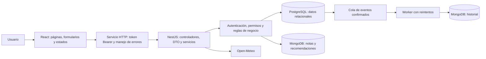
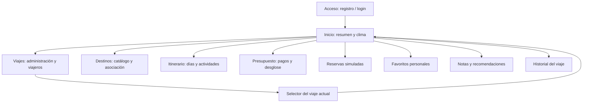

# Hito 3 — diagnóstico, alcance y demostración de TripPlan

Caso conservado: **sistema de planificación de viajes** del Taller 2. Esta entrega agrega backend propio, persistencia SQL/NoSQL y una interfaz React integrada. La aplicación móvil corresponde al Hito 4 y consumirá esta misma API.

## Diagnóstico del Taller 2

| Situación inicial | Brecha | Evolución implementada |
| --- | --- | --- |
| Actividades en estado React y `localStorage`. | Información dependiente del navegador, sin usuarios ni sincronización. | Actividades persistidas por la API; la interfaz vuelve a consultarlas desde PostgreSQL. |
| Viaje de Santiago importado desde un archivo. | No se podían administrar distintos viajes. | Creación, edición, eliminación y selección de viajes propios o compartidos. |
| Catálogo local de destinos. | Sin administración ni relación con el itinerario. | Catálogo persistido y asociación de destinos a cada viaje. |
| Actividades agrupadas visualmente por fecha. | Sin entidad de día, destino asociado ni validaciones centrales. | Días del itinerario relacionados con destinos y fechas válidas del viaje. |
| Favorito como atributo común de una actividad. | No diferenciaba usuarios. | Favoritos personales por usuario y actividad. |
| Suma de costos estimados presentada como gasto. | Se confundía planificación con pagos reales. | Registro independiente de gastos e indicadores calculados en el backend. |
| Clima consultado directamente desde React. | Validaciones y manejo del proveedor separados de la API propia. | Consulta por el backend, con caché, timeout y tratamiento del horizonte de pronóstico. |
| Sin reservas, viajeros ni documentos del viaje. | Faltaban funcionalidades obligatorias del caso. | Reservas simuladas, viajeros asociados, notas, recomendaciones e historial. |

Se reutilizan la identidad de TripPlan, su paleta, las tarjetas, la navegación, los filtros de actividades y la presentación meteorológica. Se adaptan `ActivityCard`, `ActivityForm`, `StatCard`, `TripSummary` y `WeatherCard` a datos reales. Los archivos históricos de `src/data/` se conservan como evidencia del Taller 2, pero no alimentan los procesos de la aplicación integrada.

## Actores y alcance

- **Usuario sin sesión:** puede registrar una cuenta e iniciar sesión.
- **Propietario:** administra su viaje, participantes, destinos asociados, itinerario, actividades, reservas, gastos y documentos.
- **Viajero asociado:** consulta los datos del viaje y administra sus propios favoritos.

El catálogo de destinos es compartido: un usuario puede crear destinos; su creador puede editarlos y eliminarlos si no están asociados a viajes. Las cuentas de viajeros se agregan por su correo registrado. La incorporación al viaje no envía correos ni crea cuentas automáticamente.

Todas las funcionalidades del caso se mantienen dentro del alcance. El orden siguiente describe la secuencia de implementación y demostración, no una selección de requisitos para omitir los demás.

## Historias de usuario y aceptación

Prioridad de construcción: **P1: HU01–HU03**, que habilitan acceso, viajes y participantes; **P2: HU04–HU10**, que implementan planificación y control del viaje; **P3: HU11–HU12**, que completan documentos, trazabilidad e información meteorológica. Todas son obligatorias en esta entrega.

| Historia | Necesidad y criterio verificable | Pantalla / persistencia |
| --- | --- | --- |
| HU01 — Acceso | Como usuario, quiero registrarme e iniciar sesión. Sin sesión, una ruta protegida redirige a acceso; una sesión inválida se descarta. | Acceso / usuarios SQL. |
| HU02 — Viajes | Como propietario, quiero crear, modificar y eliminar viajes con fechas y presupuesto válidos. Al volver a entrar, mis viajes permanecen. | Viajes / `trips`. |
| HU03 — Viajeros | Como propietario, quiero agregar una cuenta registrada y retirarla del viaje. El viajero puede consultar; un tercero recibe 403. | Viajes / `trip_travelers`. |
| HU04 — Destinos | Como usuario, quiero buscar y administrar destinos y asociarlos a mi viaje. Un destino en uso no se puede eliminar. | Destinos / `destinations`, `trip_destinations`. |
| HU05 — Días | Como propietario, quiero organizar el itinerario por día y destino. Se rechazan días duplicados o fuera del período del viaje. | Itinerario / `itinerary_days`. |
| HU06 — Actividades | Como propietario, quiero agregar, editar, completar, cancelar y eliminar actividades de un día. No se puede enlazar un día de otro viaje. | Itinerario / `activities`. |
| HU07 — Favoritos | Como viajero, quiero guardar mis actividades favoritas sin modificar las de otros usuarios. Persisten al recargar. | Itinerario y Favoritos / `favorites`. |
| HU08 — Reservas | Como propietario, quiero registrar, confirmar, modificar y cancelar reservas simuladas. Deben quedar dentro del viaje; una cancelada no se reactiva. | Reservas / `reservations`. |
| HU09 — Gastos | Como propietario, quiero registrar pagos y quién pagó. Un gasto debe ser positivo y puede ser anterior al viaje. | Presupuesto / `expenses`. |
| HU10 — Indicadores | Como viajero, quiero distinguir presupuesto, estimaciones, gastos y saldo. El backend calcula los totales y avisa si se excede el presupuesto. | Inicio y Presupuesto / consultas SQL. |
| HU11 — Documentos | Como propietario, quiero guardar, consultar, editar y eliminar notas y recomendaciones con etiquetas. Persisten tras recargar y volver a iniciar sesión. | Notas / MongoDB. |
| HU12 — Historial y clima | Como viajero, quiero consultar los cambios de planificación y el pronóstico disponible para un destino asociado. El sistema informa errores del proveedor y fechas sin pronóstico. | Historial e Inicio / MongoDB y Open-Meteo. |

## Arquitectura y flujo

El [modelo entidad-relación y las colecciones](../backend/README.md) están documentados junto al backend. Las [entidades](../backend/src/database/entities.ts) y la [migración inicial](../backend/src/database/migrations/1794180000000-InitialSchema.ts) son su implementación. El [contrato OpenAPI](../backend/docs/openapi.json) detalla métodos, rutas y datos de entrada.

SQL conserva usuarios, viajes, destinos, itinerarios, actividades y gastos, además de reservas y favoritos relacionados. MongoDB almacena documentos con contenido y etiquetas e historial de eventos; no duplica los registros operacionales completos. La outbox SQL es una cola técnica: confirma el evento junto al cambio y permite reintentar su entrega a MongoDB.

React conserva en `sessionStorage` únicamente el token y el identificador del viaje seleccionado. La identidad se verifica con `/users/me` al recargar. Los datos del dominio se consultan desde la API. Cerrar la sesión descarta la selección y el acceso del usuario anterior.

## Entradas y salidas de la API

La [referencia de endpoints](../backend/README.md#endpoints) y Swagger especifican método, ruta y propósito. Los DTO de Swagger describen las entradas y sus restricciones; las respuestas reales se pueden consultar con **Try it out**. Este es el contrato funcional por grupo:

| Operación | Entrada principal | Salida principal |
| --- | --- | --- |
| Registro / login | Nombre (solo registro), correo y contraseña. | `accessToken`, `tokenType`, `expiresIn` y usuario sin hash. |
| Perfil | Token; nombre para la actualización. | Usuario con `id`, nombre, correo y timestamps. |
| Crear/editar viaje | Nombre, fechas, presupuesto y descripción. | Viaje con UUID, propietario, moneda CLP y timestamps. |
| Listar/consultar viajes | Token, paginación o `tripId`. | Lista de viajes accesibles o un viaje autorizado. |
| Agregar/listar viajeros | `tripId` y correo registrado al agregar. | Identidad del viajero y rol `owner`/`traveler`. |
| Catálogo de destinos | Nombre, país, región, coordenadas y descripción. | Destino con UUID y creador; listas admiten búsqueda y paginación. |
| Asociar destinos | `tripId` y `destinationId`. | Relación creada o lista de destinos del viaje. |
| Días del itinerario | `tripId`, fecha, destino y título. | Día con UUID y referencias al viaje y destino. |
| Actividades | `tripId`, `dayId`, nombre, categoría, hora, estimación, descripción y estado. | Actividad con UUID; las consultas incluyen fecha y favorito personal. |
| Favoritos | `tripId`, identificador de actividad y token del usuario. | Estado personal de favorito o lista de actividades favoritas. |
| Reservas | Tipo, proveedor, referencia, fechas, estimación, estado y actividad opcional. | Reserva simulada con UUID y vínculos al viaje/actividad. |
| Gastos | Descripción, categoría, fecha, monto, pagador y actividad opcional. | Gasto con UUID y referencias al viaje, pagador y actividad. |
| Resumen | `tripId` y token. | Presupuesto, estimaciones, gasto real, saldo, exceso, porcentaje y contadores. |
| Notas/recomendaciones | `tripId`, título, contenido y etiquetas. | Documento MongoDB con `_id`, autor, contenido y timestamps. |
| Historial | `tripId`, token y paginación. | Eventos con identificador, actor, acción y fecha. |
| Clima | `tripId` y `destinationId` asociado. | Disponibilidad y pronóstico diario, o motivo de indisponibilidad temporal por fechas. |
| Eliminaciones | Identificador del recurso y token autorizado. | `{ "deleted": true }`, o error de integridad/permisos. |

Las fechas del dominio usan `YYYY-MM-DD`; las horas de entrada usan `HH:mm`; los importes son pesos chilenos enteros. Las listas paginadas admiten hasta cien registros por solicitud y el servicio HTTP de React recorre las páginas. Los errores comparten `statusCode`, `message`, `path` y `timestamp`.

## Navegación

Las rutas protegidas requieren sesión. El selector permite cambiar el contexto del viaje; cada pantalla vuelve a consultar sus datos. La interfaz oculta acciones que el viajero no puede ejecutar, y el backend vuelve a comprobar los permisos en cada solicitud.

## Pruebas y evidencia

| Nivel | Comando | Qué verifica |
| --- | --- | --- |
| Compilación React | `npm.cmd run build` en raíz | Componentes, imports y empaquetado. |
| Revisión estática | `npm.cmd run lint` en raíz | Reglas de JavaScript/React y archivos de pruebas. |
| Backend | `npm.cmd test` en `backend/` | Veinte pruebas HTTP, reglas, esquemas, worker y clima. SQL emulado y dobles de dependencias. |
| Integración de API real | `docker compose exec backend npm run smoke` | PostgreSQL y MongoDB reales, permisos, CRUD, totales y eventos. |
| Servicios y demo | `node backend/scripts/check-runtime.mjs` | Estado real de servicios, Swagger, datos de ejemplo y proveedor meteorológico. |
| Navegador | `npm.cmd run test:e2e` en raíz | Operaciones desde React, persistencia al recargar/reingresar, roles, errores y vista móvil con servicios reales. |

La prueba de navegador utiliza Chrome instalado en el equipo, sin abrir una ventana visible. Puede seleccionarse Edge con `E2E_BROWSER_CHANNEL=msedge`. Requiere los servicios de Docker iniciados y el frontend reconstruido con los cambios. Crea cuentas ficticias distintas por ejecución y elimina el viaje y destino de prueba; las cuentas permanecen. Los reportes y capturas quedan en `test-results/`, fuera de Git. Las solicitudes se espacian para respetar los límites reales por IP.

**Resultado técnico de la integración:** compilación de producción en Docker y revisión estática aprobadas; recorrido completo de navegador aprobado con servicios reales, incluyendo persistencia, errores, roles, edición, eliminación y vista móvil. El backend conserva sus veinte pruebas automatizadas y la comprobación `smoke` real documentadas en su README. Este resultado técnico no reemplaza la revisión humana del equipo.

## Guion de demostración

1. Iniciar Compose y mostrar `/api/v1/health` con ambas bases disponibles.
2. Registrar una cuenta desde la web o iniciar sesión con la cuenta demo local.
3. Crear un viaje con fechas y presupuesto; mostrarlo desde otra consulta o después de recargar.
4. Crear un destino, asociarlo al viaje y agregar un día del itinerario.
5. Intentar agregar el mismo día y mostrar el error de validación; comprobar que la información anterior sigue disponible.
6. Agregar una actividad, editar su estado y marcarla como favorita.
7. Registrar un gasto real diferente del costo estimado y mostrar que Inicio y Presupuesto distinguen ambos valores.
8. Crear y cancelar una reserva simulada. Intentar borrar una actividad con gastos/reservas para mostrar la regla de integridad.
9. Guardar una nota y una recomendación; recargar y comprobar su persistencia documental.
10. Consultar el historial. Explicar por qué un evento puede tardar unos segundos en aparecer.
11. Agregar una segunda cuenta como viajero y mostrar la lectura y los favoritos personales, junto a la ausencia de acciones de administración.
12. Cerrar sesión y volver a entrar para demostrar recuperación de datos desde las bases.
13. Abrir Swagger y ejecutar una consulta usando el token obtenido por login.

## Uso de IA y revisión humana

Se utilizó Codex para análisis, diseño, implementación, depuración, pruebas y documentación. La guía de Sites se utilizó como apoyo de implementación y revisión local; el proyecto conserva React, NestJS y Docker Compose.

| Etapa | Instrucción representativa | Resultado y verificación técnica |
| --- | --- | --- |
| Backend | Crear el backend recomendado con NestJS, PostgreSQL y MongoDB conforme al caso de Viajes. | API, migraciones, permisos, Swagger, Compose y pruebas de servicios. |
| Integración | Completar los flujos pendientes de React y la entrega del Hito 3, limitándose a lo solicitado. | Servicio HTTP, sesión, formularios y pantallas conectadas, estados y pruebas de navegador. |
| Depuración | Revisar Docker y comprobar las operaciones sobre bases reales. | Verificación de contenedores, smoke y datos de demostración. |

La validación automatizada no acredita por sí sola comprensión humana. El equipo debe completar lo siguiente antes de entregar:

- [ ] Revisar y explicar los cambios que incorporará, y registrar adaptaciones o propuestas descartadas.
- [ ] Explicar las relaciones SQL y justificar el uso complementario de MongoDB.
- [ ] Comprender autenticación, permisos, DTO, códigos HTTP y tratamiento de errores.
- [ ] Ejecutar la demostración desde un entorno del equipo y registrar sus resultados.
- [ ] Revisar historias, diagramas, README e integrantes y practicar la defensa individual.
- [ ] Documentar aprendizajes reales del equipo; no atribuirse revisiones todavía no realizadas.

## Trabajo con Git

La documentación original describe ramas `main`, `develop` y ramas de funcionalidad. El equipo debe aplicar su estrategia acordada y mantener contribuciones identificables; no se crean commits a nombre de integrantes ni se publica o fusiona código automáticamente. Los cambios de esta integración quedan disponibles para revisión mediante `git diff` y `git status`.

Las credenciales y los artefactos de ejecución se mantienen fuera de Git. Los archivos `.env.example`, las migraciones, el lockfile y las instrucciones permiten reproducir el entorno sin compartir claves locales.
