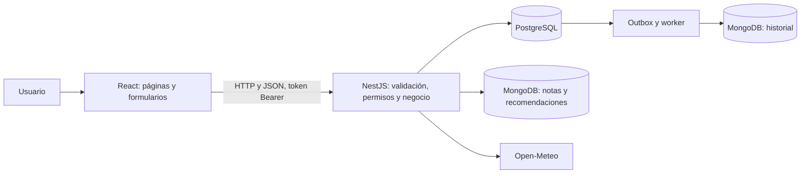

# Resumen de construcción de TripPlan

Este documento reconstruye el trabajo realizado durante esta conversación para evolucionar el proyecto del Taller 2 hacia el Hito 3. La comparación de archivos utiliza `e9fe96a` como punto de partida y `c89c67f` como versión consolidada existente al preparar el informe: **84 archivos creados y 16 archivos modificados**. Este resumen es un documento adicional a ese inventario. Los `.env` y los artefactos generados se describen aparte porque no están versionados.

## 1. Punto de partida

TripPlan ya tenía un frontend React con Vite: dashboard, itinerario, destinos, favoritos, tarjetas, filtros y consulta del clima. Las actividades se guardaban en `localStorage`, el viaje principal se importaba desde `src/data/viajes.js` y el catálogo de destinos era local. El dashboard sumaba costos estimados de actividades como si fueran gastos efectivamente pagados.

No existían API propia, cuentas, permisos, persistencia compartida ni pantallas para todos los procesos exigidos por el caso de Viajes.

## 2. Paso a paso del trabajo

1. **Lectura del enunciado.** Se revisó el DOCX del Hito 3 y se distinguieron sus requisitos del pedido del usuario. Se identificó la continuidad obligatoria con el Taller 2, PostgreSQL, NoSQL, API REST, Swagger, Docker Compose y las funcionalidades del caso de Viajes.
2. **Revisión del proyecto existente.** Se inspeccionaron dependencias, componentes, páginas, almacenamiento local e integración de Open-Meteo. Se identificaron los elementos reutilizables y las brechas.
3. **Elección de arquitectura.** Se recomendó NestJS con TypeScript por continuidad con el ecosistema JavaScript del frontend, PostgreSQL con TypeORM, MongoDB con Mongoose y un backend único que pueda reutilizarse desde React Native en el Hito 4.
4. **Diseño de datos y permisos.** Se definieron usuarios, propietarios, viajeros, viajes, destinos, días, actividades, reservas, favoritos y gastos. Se eligió CLP y se separaron costos estimados de pagos reales. El propietario administra; los viajeros consultan y guardan sus propios favoritos.
5. **Construcción del backend.** Se crearon módulos NestJS, controladores, servicios, DTO, autenticación JWT, hashes bcrypt, validación de identificadores, manejo uniforme de errores y configuración por variables de entorno.
6. **Persistencia reproducible.** Se implementaron entidades y una migración SQL con tablas, claves y restricciones. Se crearon colecciones MongoDB para notas, recomendaciones y eventos. Se agregó un seed repetible con una cuenta y viaje de demostración.
7. **Historial y API pública.** Se agregó una outbox SQL y un worker para entregar eventos a MongoDB con reintentos e identificadores únicos. Open-Meteo pasó a consultarse desde el backend con autorización, caché, timeout y manejo de fechas fuera del pronóstico.
8. **Documentación y ejecución inicial.** Se prepararon Swagger con 52 operaciones, contrato OpenAPI exportable, Dockerfiles, Compose, Nginx y ejemplos de variables. Un script generó claves locales aleatorias sin imprimirlas.
9. **Resolución del entorno Windows.** Al principio Docker no estaba disponible y Windows informó WSL ausente y un reinicio pendiente. Se entregaron pasos para completar Docker Desktop/WSL y reiniciar. El usuario realizó la instalación y los reinicios; después se verificó el motor y los cuatro servicios funcionando.
10. **Pruebas reales del backend.** Se ejecutó el flujo smoke contra PostgreSQL y MongoDB reales, se cargó el seed y se verificaron Swagger, el viaje demo y el clima real. La cuenta demo quedó con 350.000 CLP de presupuesto, 8.000 CLP de gastos y 342.000 CLP disponibles.
11. **Integración completa de React.** Tras la autorización del usuario, se reemplazó el uso operacional de datos locales por llamadas a la API. Se implementaron sesión, rutas protegidas, selección de viaje, formularios, permisos visuales y todas las pantallas exigidas.
12. **Pruebas de navegador y cierre técnico.** Se ejecutó un recorrido con Chrome y bases reales: registro, viajes, destinos, actividades, presupuesto, reservas, documentos, historial, roles, persistencia, errores, edición, eliminación y vista móvil. Se revisaron capturas, se actualizó el contenedor frontend y se completó la documentación académica.

Durante las pruebas se corrigió la configuración de ejecución de TypeScript para conservar los metadatos requeridos por NestJS. También se aisló la zona horaria del proceso de prueba de `pg-mem` para evitar el desfase de fechas del emulador, y se ajustó la prueba de navegador para esperar el guardado confirmado antes de recargar una nota. Estas correcciones forman parte de la verificación, no de funcionalidades adicionales.

## 3. Cómo funciona lo construido



Ejemplo: al registrar un gasto, React reúne los campos y el servicio HTTP envía una solicitud con el token. El backend comprueba la sesión, la pertenencia al viaje, los permisos y los datos. El servicio guarda el gasto y su evento en una transacción SQL. Después, React vuelve a consultar los datos y el resumen; el worker entrega el evento al historial de MongoDB.

El navegador conserva únicamente el token y el identificador del viaje seleccionado en `sessionStorage`. Usuarios, viajes, actividades, reservas, favoritos, gastos y documentos se recuperan de la API. Los totales presupuestarios se calculan en el backend.

## 4. Qué se creó en el backend

| Grupo | Archivos principales y responsabilidad |
| --- | --- |
| Arranque | `src/main.ts` inicia el servidor; `src/app.module.ts` reúne módulos y conexiones; `src/setup-app.ts` configura prefijo REST, CORS, validación, errores y Swagger. |
| Configuración | `src/config/environment.ts` valida variables. `package.json`, `package-lock.json` y los dos `tsconfig` definen dependencias, comandos y compilación. |
| Acceso | `src/auth/` contiene controller, DTO, guard, module y service para registro, login, perfil y tokens. |
| Viajes | `src/trips/` contiene CRUD, viajeros, destinos asociados, indicadores y el servicio de acceso por viaje. |
| Destinos | `src/destinations/` administra el catálogo y su propiedad. |
| Planificación | `src/planning/` gestiona días, actividades, favoritos, reservas y gastos. |
| Documentos | `src/documents/` contiene esquemas MongoDB y operaciones sobre notas, recomendaciones e historial. |
| Auditoría | `src/audit/enqueue.ts` registra eventos pendientes; `audit.worker.ts` los entrega y reintenta; `audit.module.ts` integra el worker. |
| Clima | `src/weather/` consulta Open-Meteo y controla disponibilidad, caché y errores. |
| Datos SQL | `src/database/entities.ts`, `data-source.ts`, la migración inicial y `seed.ts` definen el modelo y su inicialización. |
| Utilidades | `src/common/` centraliza validación, UUID y errores. `src/health.controller.ts` verifica ambas bases. |
| Documentación | `docs/openapi.json` y `README.md` describen el contrato y las decisiones técnicas. |

En los módulos, el **controller** recibe HTTP; el **DTO** define y valida la entrada; el **service** aplica las reglas; el **module** conecta sus dependencias. TypeORM accede a PostgreSQL y Mongoose a MongoDB.

Las tablas son `app_users`, `trips`, `trip_travelers`, `destinations`, `trip_destinations`, `itinerary_days`, `activities`, `favorites`, `reservations`, `expenses` y la cola técnica `audit_outbox`. Las colecciones son `trip_notes`, `trip_recommendations` y `trip_events`.

## 5. Qué se creó y adaptó en React

| Archivo o grupo | Trabajo realizado |
| --- | --- |
| `src/services/api.js` | Cliente HTTP, envío del token, errores, expiración de sesión y recorrido de páginas de resultados. |
| `src/services/format.js` | Formato CLP, fecha actual y catálogos estáticos de categorías/estados. |
| `src/context/AuthProvider.jsx`, `auth-context.js` | Sesión, validación del perfil, entrada y salida de usuarios. |
| `src/context/TripProvider.jsx`, `trip-context.js` | Viajes disponibles, viaje seleccionado, permisos y actualización de datos. |
| `src/hooks/useResource.js` | Consulta de datos, cancelación de solicitudes obsoletas, carga, errores y reintentos. |
| `src/hooks/useAction.js` | Estado de guardado y mensajes de éxito/error de las acciones. |
| `src/components/EntityForm.jsx` | Formularios reutilizables con campos accesibles, validación y guardado asíncrono. |
| `src/components/Feedback.jsx` | Estados de carga, error, éxito, ausencia de viaje y acceso de lectura. |
| `src/pages/Auth.jsx` | Registro e inicio de sesión. |
| `src/pages/Viajes.jsx` | Crear, editar y eliminar viajes; administrar viajeros. |
| `src/pages/Presupuesto.jsx` | Gastos reales, pagadores, indicadores y desglose por categoría. |
| `src/pages/Reservas.jsx` | Reservas simuladas, estados, cancelación y eliminación. |
| `src/pages/Documentos.jsx` | Notas y recomendaciones persistidas en MongoDB. |
| `src/pages/Historial.jsx` | Consulta y actualización del historial del viaje. |
| `src/styles/integration.css` | Estilos de las funciones nuevas y adaptación responsive dentro de la paleta existente. |

Las pantallas existentes `Dashboard`, `Destinos`, `Itinerario` y `Favoritos` se adaptaron para consultar la API. `ActivityForm`, `ActivityCard`, `Navbar` y `TripSummary` se modificaron para esos flujos. `StatCard` y `WeatherCard` se reutilizaron sin modificar sus archivos, pasando los datos adecuados desde sus componentes padres.

## 6. Archivos existentes modificados

| Archivo | Motivo |
| --- | --- |
| `.gitignore` | Excluir secretos, compilados y resultados de pruebas. |
| `eslint.config.js` | Separar alcance frontend/backend y reconocer archivos de pruebas/configuración. |
| `index.html` | Idioma español, título y descripción de TripPlan. |
| `package.json` | Dependencia de Playwright y comando de prueba de navegador. |
| `package-lock.json` | Versiones exactas de dependencias para instalaciones reproducibles con `npm ci`. |
| `src/App.jsx` | Rutas protegidas, proveedores de sesión/viaje y selector del viaje activo. |
| `src/main.jsx` | Cargar los estilos de integración. |
| `src/components/ActivityCard.jsx` | Mostrar datos reales, estados, favoritos y acciones autorizadas. |
| `src/components/ActivityForm.jsx` | Crear/editar actividades asociadas a un día persistido. |
| `src/components/Navbar.jsx` | Navegación de los flujos nuevos, usuario y cierre de sesión. |
| `src/components/TripSummary.jsx` | Resumen basado en indicadores del backend. |
| `src/pages/Dashboard.jsx` | Datos del viaje seleccionado, pagos reales y clima por la API propia. |
| `src/pages/Destinos.jsx` | Catálogo real, búsqueda, edición y asociación al viaje. |
| `src/pages/Favoritos.jsx` | Favoritos personales persistidos por usuario. |
| `src/pages/Itinerario.jsx` | Días y actividades reales, filtros y reglas de negocio. |
| `vite.config.js` | Proxy local de `/api` hacia el backend durante desarrollo. |

## 7. Docker, configuración y herramientas

- `compose.yaml`: levanta PostgreSQL, MongoDB, backend y frontend con dependencias, healthchecks, puertos locales y volúmenes persistentes.
- `backend/Dockerfile`: compila TypeScript y ejecuta la API en Node.js.
- `Dockerfile.web`: compila React con Vite y sirve el resultado con Nginx.
- `docker/nginx.conf`: sirve las rutas de React y dirige `/api` y `/docs` al backend.
- `.dockerignore` y `backend/.dockerignore`: excluyen dependencias locales, secretos y salidas que no deben enviarse a la construcción.
- `.env.example` y `backend/.env.example`: plantillas sin claves reales.
- `backend/scripts/setup-env.mjs`: genera los `.env` locales con claves aleatorias y conserva configuraciones ya existentes.
- `backend/scripts/export-openapi.cjs`: exporta la documentación a partir de los controladores sin iniciar bases.
- `backend/scripts/smoke.mjs`: comprueba el flujo de API con bases reales.
- `backend/scripts/check-runtime.mjs`: verifica servicios, demo, Swagger y clima sin modificar los datos.

Los archivos `.env` de raíz y backend se generaron localmente y no se incluyen en Git. `node_modules`, `dist`, `dist-test` y `test-results` son artefactos de instalación, compilación o pruebas; no son archivos fuente escritos manualmente. El informe no reproduce contraseñas ni tokens.

## 8. Cómo se verificó

| Comprobación | Alcance y resultado registrado |
| --- | --- |
| Backend: `npm test` | Veinte pruebas automatizadas aprobadas. Incluyen HTTP, migración sobre `pg-mem`, reglas, esquemas documentales, permisos, reintentos y clima simulado. |
| API real: `npm run smoke` | Flujo aprobado con PostgreSQL y MongoDB reales dentro de Docker. |
| Compilación y lint | Compilación de producción y revisión estática aprobadas. |
| Navegador: `npm run test:e2e` | Un recorrido automatizado con varios pasos, aprobado con Chrome y bases reales. Incluye persistencia, roles, errores de conexión, edición, eliminación y pantalla móvil. |
| Revisión visual | Capturas de escritorio y móvil revisadas, incluyendo datos e indicadores ya cargados. |
| Servicios y demo | Cuatro contenedores disponibles; backend y bases saludables; 52 operaciones Swagger y siete días de pronóstico real comprobados en la verificación documentada. |

Las pruebas con emuladores y dobles no se presentan como pruebas sobre bases reales: esas verificaciones se hicieron por separado mediante smoke, comprobación local y navegador. Los datos ficticios de viaje/destino utilizados por las pruebas se limpiaron; las cuentas ficticias de prueba permanecen.

## 9. Documentación entregada y estado final

- `README.md`: entrada general al proyecto, arquitectura, tecnologías, comandos y alcance actual.
- `backend/README.md`: modelo relacional/documental, permisos, reglas, endpoints y pruebas.
- `INICIAR_BACKEND.md`: pasos Windows/Docker, cuenta demo, uso de la web, Swagger y solución de problemas.
- `docs/HITO_3.md`: diagnóstico, actores, historias priorizadas, aceptación, navegación, arquitectura, contrato funcional, demostración y revisión humana.

La aplicación quedó integrada para el Hito 3. Conserva la identidad visual y la continuidad del Taller 2; las reservas son simuladas y el presupuesto usa CLP. React Native corresponde al Hito 4. La revisión del código por el equipo, el registro de aprendizajes reales y la defensa individual son tareas humanas que no se marcan como realizadas por una herramienta.

El historial existente registra `8a8f45f` (Backend), `080fe54` (Actualización de Dockers funcionando) y `c89c67f` (Backend Listo). Son referencias a versiones del repositorio; este informe no atribuye al asistente la creación de esos commits.

## 10. Inventario completo de archivos creados

Rutas relativas a `viajes/`, clasificadas como nuevas frente al frontend original:

```text
.dockerignore
.env.example
Dockerfile.web
INICIAR_BACKEND.md
README.md
backend/.dockerignore
backend/.env.example
backend/Dockerfile
backend/README.md
backend/docs/openapi.json
backend/package-lock.json
backend/package.json
backend/scripts/check-runtime.mjs
backend/scripts/export-openapi.cjs
backend/scripts/setup-env.mjs
backend/scripts/smoke.mjs
backend/src/app.module.ts
backend/src/audit/audit.module.ts
backend/src/audit/audit.worker.ts
backend/src/audit/enqueue.ts
backend/src/auth/auth.controller.ts
backend/src/auth/auth.dto.ts
backend/src/auth/auth.guard.ts
backend/src/auth/auth.module.ts
backend/src/auth/auth.service.ts
backend/src/common/http-exception.filter.ts
backend/src/common/id.decorator.ts
backend/src/common/validation.ts
backend/src/config/environment.ts
backend/src/database/data-source.ts
backend/src/database/entities.ts
backend/src/database/migrations/1794180000000-InitialSchema.ts
backend/src/database/seed.ts
backend/src/destinations/destinations.controller.ts
backend/src/destinations/destinations.dto.ts
backend/src/destinations/destinations.module.ts
backend/src/destinations/destinations.service.ts
backend/src/documents/documents.controller.ts
backend/src/documents/documents.dto.ts
backend/src/documents/documents.module.ts
backend/src/documents/documents.service.ts
backend/src/documents/schemas.ts
backend/src/health.controller.ts
backend/src/main.ts
backend/src/planning/planning.controller.ts
backend/src/planning/planning.dto.ts
backend/src/planning/planning.module.ts
backend/src/planning/planning.service.ts
backend/src/setup-app.ts
backend/src/trips/trip-access.service.ts
backend/src/trips/trips.controller.ts
backend/src/trips/trips.dto.ts
backend/src/trips/trips.module.ts
backend/src/trips/trips.service.ts
backend/src/weather/weather.controller.ts
backend/src/weather/weather.module.ts
backend/src/weather/weather.service.ts
backend/test/api.spec.ts
backend/test/documents-audit.spec.ts
backend/test/weather.spec.ts
backend/tsconfig.json
backend/tsconfig.test.json
compose.yaml
docker/nginx.conf
docs/HITO_3.md
playwright.config.js
src/components/EntityForm.jsx
src/components/Feedback.jsx
src/context/AuthProvider.jsx
src/context/TripProvider.jsx
src/context/auth-context.js
src/context/trip-context.js
src/hooks/useAction.js
src/hooks/useResource.js
src/pages/Auth.jsx
src/pages/Documentos.jsx
src/pages/Historial.jsx
src/pages/Presupuesto.jsx
src/pages/Reservas.jsx
src/pages/Viajes.jsx
src/services/api.js
src/services/format.js
src/styles/integration.css
tests/e2e/tripplan.spec.js
```

Los 16 archivos modificados son los enumerados en la sección 6. Como comprobación del inventario, las rutas modificadas obtenidas de Git son:

```text
.gitignore
eslint.config.js
index.html
package-lock.json
package.json
src/App.jsx
src/components/ActivityCard.jsx
src/components/ActivityForm.jsx
src/components/Navbar.jsx
src/components/TripSummary.jsx
src/main.jsx
src/pages/Dashboard.jsx
src/pages/Destinos.jsx
src/pages/Favoritos.jsx
src/pages/Itinerario.jsx
vite.config.js
```

